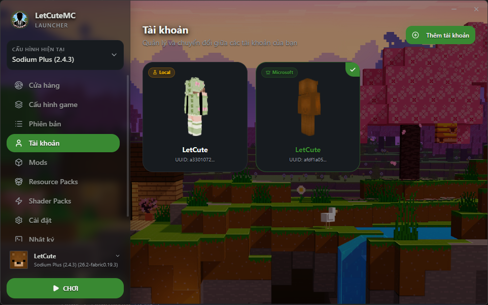

<div align="center">
  
  <h1>LetCuteMC Launcher</h1>
  <p><b>Trình khởi chạy Minecraft hiện đại, tốc độ cao, giao diện Dark Glassmorphism sang trọng và toàn diện cho game thủ & modder.</b></p>
  
  
  
</div>

Dự án được xây dựng trên nền tảng **Electron**, **React**, **TypeScript** và **Tailwind CSS**, tích hợp hệ thống thư viện lõi **@xmcl** mạnh mẽ cùng kiến trúc **Zero-Reflow GPU Tabs** cho trải nghiệm mượt mà 60 FPS trên mọi cấu hình máy tính.

---

## 📚 Bộ Tài Liệu Kỹ Thuật (Technical Documentation)

Để hỗ trợ việc tìm hiểu kiến trúc, phát triển tính năng mới cũng như bảo trì hệ thống, dự án cung cấp bộ tài liệu kỹ thuật chi tiết tại thư mục [`docs/`](file:///e:/website-app/LetCuteMC/docs):

* 🏗️ **[Kiến Trúc Hệ Thống (ARCHITECTURE.md)](file:///e:/website-app/LetCuteMC/docs/ARCHITECTURE.md)**: Mô hình đa tiến trình (Main, Renderer, Worker Threads), cơ chế giao tiếp IPC bảo mật, kiến trúc GPU Keep-Alive.
* ⚙️ **[Chi Tiết Services & Workers (SERVICES.md)](file:///e:/website-app/LetCuteMC/docs/SERVICES.md)**: Phân tích danh mục 35 backend services và 2 worker xử lý ngầm (`launchWorker`, `prepareWorker`).
* 🔌 **[Danh Mục IPC Channel & API (IPC_API.md)](file:///e:/website-app/LetCuteMC/docs/IPC_API.md)**: Tra cứu chi tiết toàn bộ các kênh IPC `window.launcherApi` và các sự kiện thời gian thực.
* 🎯 **[Đặc Tả Tính Năng Kỹ Thuật (FEATURES_SPEC.md)](file:///e:/website-app/LetCuteMC/docs/FEATURES_SPEC.md)**: Cơ chế quét & tự động cài Java OpenJDK, tải song song & xác minh SHA-1, quản lý Mods/ResourcePacks và xác thực Microsoft.
* 🛠️ **[Hướng Dẫn Phát Triển & Đóng Gói (DEVELOPER_GUIDE.md)](file:///e:/website-app/LetCuteMC/docs/DEVELOPER_GUIDE.md)**: Cài đặt môi trường, danh mục các lệnh script (`npm run dev`, `build`, `dist`) và cấu trúc dự án.

---

## ✨ Tính Năng Nổi Bật

### 🎮 1. Quản Lý Cấu Hình Game (Profiles)
* **Độc lập hoàn toàn:** Mỗi cấu hình có thể chỉ định thư mục game riêng (`gameDir`), phiên bản Java riêng, mức RAM Min/Max riêng.
* **Hỗ trợ mọi ModLoader:** Hỗ trợ đầy đủ Vanilla, Snapshot, Forge, Fabric, Quilt và NeoForge.
* **Xuất / Nhập Cấu Hình:** Dễ dàng chia sẻ cấu hình modpack qua tệp `.letcuteprofile.zip` chỉ với 1 click.
* **Khởi động siêu tốc:** Cơ chế Fast Launch và kiểm tra chuẩn bị game nền (Background Prepare).

### 🛒 2. Cửa Hàng Modrinth Tích Hợp (Store)
* **Kho tài nguyên phong phú:** Tìm kiếm trực tiếp hàng ngàn Mods, Modpacks, Resource Packs và Shader Packs từ Modrinth API.
* **Lọc thông minh:** Tự động lọc theo phiên bản Minecraft và ModLoader tương thích với cấu hình hiện tại.
* **Cài đặt 1-Click:** Tự động tải và phân loại file vào đúng thư mục cấu hình.

### ⚡ 3. Quản Lý Mods & Chẩn Đoán Xung Đột (Mods Manager)
* **Bật / Tắt nhanh:** Chuyển đổi trạng thái mod nhanh chóng (`.jar` ⇋ `.jar.disabled`) không cần xóa tệp.
* **Kéo thả cài đặt:** Hỗ trợ kéo thả trực tiếp tệp `.jar` từ máy tính vào Launcher.
* **Tự động phát hiện xung đột:** Quét và cảnh báo các mod bị thiếu Dependency hoặc xung đột phiên bản trước khi vào game.
* **Kiểm tra bản cập nhật:** Tự động đối chiếu hash với Modrinth để thông báo khi có bản mod mới.

### 🌍 4. Quản Lý Thế Giới & Chế Độ Streamer (Worlds)
* **Phân tích NBT chuyên sâu:** Hiển thị tên bản đồ, chế độ chơi (Sinh tồn, Sáng tạo, Hardcore, Phiêu lưu), độ khó, phiên bản, dung lượng và lần chơi cuối.
* **Sao lưu & Phục hồi:** Tạo bản sao lưu `.zip` an toàn và khôi phục nhanh chóng.
* **🛡️ Chế độ Streamer Safe (Che Giấu Seed):**
  * Tự động ẩn Seed (`••••••••••••••••`) để chống lộ tọa độ thế giới khi livestream.
  * Tích hợp nút con mắt (👁️) bật/tắt hiển thị an toàn và nút sao chép Seed vào clipboard.

### 🎨 5. Resource Packs & Shader Packs
* Đọc tệp `pack.mcmeta` và hiển thị ảnh mô tả thumbnail trực quan.
* Kéo thả cài đặt tệp `.zip` và bật/tắt nhanh chóng.

### 📸 6. Thư Viện Ảnh Chụp Màn Hình (Screenshots Studio)
* Tự động quét và gom nhóm ảnh theo Ngày / Tháng.
* Trình xem ảnh phóng to toàn màn hình (Lightbox viewer) hỗ trợ phím mũi tên `←` / `→`.
* Nút sao chép ảnh trực tiếp vào Clipboard để gửi vào Discord / Facebook nhanh chóng.

### 📊 7. Thống Kê & Thành Tựu Người Chơi (Stats)
* Quét và phân tích dữ liệu `stats/<uuid>.json` từ Minecraft.
* **Gộp thế giới thông minh:** Gom toàn bộ dữ liệu người chơi theo từng thế giới, không bị trùng lặp mục.
* **Huy hiệu K/D & Khoáng sản quý:** Hiển thị tổng giờ chơi, số lượng Kim Cương / Netherite đã đào, chiến tích diệt quái kèm **Pill Badge K/D** riêng biệt.
* **Chi tiết đầy đủ:** Khai khoáng, Chiến đấu, Quãng đường (Đi bộ, Bơi, Bay Elytra, Thuyền) và Sinh tồn.

### 📜 8. Nhật Ký Thời Gian Thực & Trợ Lý Bắt Lỗi (Game Logs)
* Stream log game trực tiếp khi Minecraft đang chạy qua ring-buffer hiệu năng cao.
* Bộ lọc theo cấp độ (`INFO`, `WARN`, `ERROR`, `FATAL`) và tìm kiếm văn bản / regex.
* Tự động nhận diện nguyên nhân Crash (thiếu RAM, lỗi driver card đồ họa, xung đột mod) và gợi ý cách khắc phục.

### 👤 9. Quản Lý Tài Khoản & Skin (Accounts)
* **Tài khoản Offline (Virtual):** Tùy chỉnh tên nhân vật với UUID cố định để giữ nguyên tiến trình chơi.
* **Đăng nhập Microsoft / Xbox chính thức:** Xác thực thông qua OAuth2 / Device Code Flow chuẩn bảo mật.
* **Quản lý Skin & Áo choàng 3D:** Xem trước skin dạng 3D trực quan và tải skin lên tài khoản.

### ⚙️ 10. Tinh Chỉnh Hiệu Năng & Cài Đặt Hệ Thống (Settings)
* **Tự động quét & Cài đặt Java OpenJDK:** Nhận diện Java 8, 11, 16, 17, 21, 25; tự động tải OpenJDK tương thích nếu máy chưa có.
* **Đề xuất RAM thông minh:** Tính toán theo cấu hình RAM thực tế của máy tính.
* **JVM Presets cao cấp:** Cung cấp sẵn các bộ cờ tối ưu hóa bộ nhớ (`Aikar's Flags`, `Shenandoah GC`, `ZGC`).
* **Đồng bộ đồ họa UI (High / Medium / Low):** Tự động chuyển đổi giao diện sang chế độ siêu nhẹ trên máy yếu (tắt toàn bộ GPU blur & shadow).
* **Dọn dẹp ổ đĩa:** Quét và giải phóng bộ nhớ đệm cache tệp tin tạm.

### 🌐 11. Tự Động Hóa Máy Chủ Việt Nam (Auto Server List)
* Tự động nạp danh sách Server Top VN vào `servers.dat`.
* Bảo toàn máy chủ riêng do người chơi tự thêm.
* Tự động kích hoạt Tiếng Việt, Unicode font và chấp nhận Server Resource Packs.

### 💬 12. Discord Rich Presence (RPC) & Auto-Updater
* Hiển thị trạng thái đang chơi / đang ở sảnh lên Discord Profile.
* Tự động kiểm tra và tải bản cập nhật mới nhất từ GitHub Releases.

---

## 🛠️ Công Nghệ Sử Dụng

* **Khung ứng dụng:** Electron 34+ & Node.js
* **Giao diện:** React 18, Vite 8, TypeScript
* **Styling & GPU:** Tailwind CSS, GPU Zero-Reflow Layer (`content-visibility: hidden`), Dynamic Graphic Presets
* **Minecraft Core:** `@xmcl/core`, `@xmcl/installer`, `@xmcl/unzip`, `prismarine-nbt`

---

## 🚀 Hướng Dẫn Nhanh Phát Triển & Đóng Gói

### Cài đặt dependencies
```bash
npm install
```

### Chạy ứng dụng ở môi trường Phát triển (Dev)
```bash
npm run dev
```

### Build biên dịch ứng dụng
```bash
npm run build
```

### Đóng gói ứng dụng thành phẩm (Production Build)

**Bản cài đặt Windows Installer (`.exe`) & Portable:**
```bash
npm run dist
```

**Bản Portable Windows độc lập:**
```bash
npm run dist:portable
```

**Bản Linux (AppImage & DEB):**
```bash
npm run dist:appimage
npm run dist:deb
```

*Sau khi chạy, các bộ cài đặt thành phẩm sẽ được lưu tại thư mục `release/`.*

---

## 📁 Cấu Trúc Thư Mục Chính

* `docs/`: Bộ tài liệu kỹ thuật toàn diện của dự án (IPC, Architecture, Features, Services).
* `src/main/`: Mã nguồn tiến trình Electron Main và 35 Services chạy nền.
* `src/main/workers/`: Các worker tiến trình độc lập xử lý tải game (`prepareWorker.ts`) và khởi chạy game (`launchWorker.ts`).
* `src/renderer/`: Giao diện người dùng (React, components, 15 màn hình screens, custom hooks).
* `src/shared/`: Định nghĩa kiểu dữ liệu (Types) dùng chung giữa Main và Renderer.
* `public/`: Tài nguyên tĩnh phục vụ dev & build.
