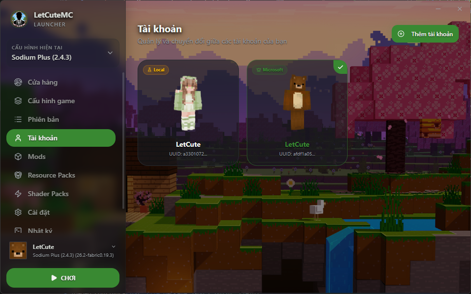

<div align="center">
  
  <h1>LetCuteMC Launcher</h1>
  <p><b>Một trình khởi chạy Minecraft hiện đại, hiệu năng cao và giàu tính thẩm mỹ.</b></p>
  
  
  *(Thêm ảnh chụp màn hình giao diện launcher của bạn vào thư mục docs/assets/screenshot.png)*
</div>

Dự án được phát triển dựa trên **Electron**, **React**, **TypeScript**, sử dụng hệ thống thư viện lõi **@xmcl** mạnh mẽ để quản lý việc tải và vận hành game.

## 📚 Bộ Tài Liệu Kỹ Thuật (Technical Documentation)

Để hỗ trợ việc tìm hiểu kiến trúc, phát triển tính năng mới cũng như bảo trì hệ thống, dự án cung cấp bộ tài liệu kỹ thuật chi tiết tại thư mục [`docs/`](file:///e:/website-app/LetCuteMC/docs):

* 🏗️ **[Kiến Trúc Hệ Thống (ARCHITECTURE.md)](file:///e:/website-app/LetCuteMC/docs/ARCHITECTURE.md)**: Mô hình đa tiến trình (Main, Renderer, Worker Threads), cơ chế giao tiếp IPC bảo mật, luồng khởi chạy game.
* ⚙️ **[Chi Tiết Services & Workers (SERVICES.md)](file:///e:/website-app/LetCuteMC/docs/SERVICES.md)**: Phân tích danh mục 20 backend services và 2 tiến trình xử lý ngầm (launchWorker, prepareWorker).
* 🔌 **[Danh Mục IPC Channel & API (IPC_API.md)](file:///e:/website-app/LetCuteMC/docs/IPC_API.md)**: Tra cứu chi tiết toàn bộ các phương thức bridge `window.launcherApi` và các sự kiện thời gian thực.
* 🎯 **[Đặc Tả Tính Năng Kỹ Thuật (FEATURES_SPEC.md)](file:///e:/website-app/LetCuteMC/docs/FEATURES_SPEC.md)**: Cơ chế quét & tự động cài Java OpenJDK, tải song song & xác minh SHA-1, quản lý Mods/ResourcePacks và xác thực Microsoft.
* 🛠️ **[Hướng Dẫn Phát Triển & Đóng Gói (DEVELOPER_GUIDE.md)](file:///e:/website-app/LetCuteMC/docs/DEVELOPER_GUIDE.md)**: Cài đặt môi trường, danh mục các lệnh script (`npm run dev`, `build`, `dist`) và cấu trúc dự án.

---

## ✨ Tính Năng Nổi Bật

* **Quản lý Cấu hình (Profiles)**: Dễ dàng thêm, sửa, xoá cấu hình phiên bản Minecraft. Hỗ trợ tùy chỉnh thư mục game, phân bổ bộ nhớ (RAM), Java Runtime riêng biệt cho từng cấu hình.
* **Cơ chế xác thực tài khoản**:
  * Chế độ chơi Offline (Tài khoản ảo).
  * Đăng nhập Microsoft/Xbox chính thức.
* **Tự động hóa thông minh (Mới)**:
  * 🌐 **Tự động thêm Server Top VN**: Tự động lấy danh sách các máy chủ Minecraft hàng đầu Việt Nam và nạp thẳng vào danh sách máy chủ trong game của bạn mà không hề gây chậm trễ khởi động.
  * ⚙️ **Thiết lập mặc định tối ưu**: Tự động cài đặt sẵn **ngôn ngữ Tiếng Việt**, **bật phông chữ Unicode**, và **tự động chấp nhận tải Resource Pack** cho các server để bạn có trải nghiệm chơi liền mạch nhất.
  * 🛡️ **Bảo vệ Server riêng**: Thuật toán quét và xóa thông minh thông qua IP giúp chống trùng lặp server hoàn hảo, đảm bảo không bao giờ xóa nhầm server do chính người chơi tự thêm.
* **Quản lý Tài nguyên tích hợp**:
  * Quản lý Mods, Resource Packs (Gói tài nguyên) và Shader Packs trực tiếp trên giao diện trực quan.
  * Bật/tắt nhanh hoặc xoá bỏ tài nguyên chỉ với 1 click.
* **Xác thực & Tải tệp tin game thông minh**:
  * Tự động quét, đối chiếu kích thước tệp tin trước khi vào game.
  * Hỗ trợ tải song song (lên đến 16 luồng đồng thời) các tệp tin asset, thư viện (libraries) và client jar từ Mojang.
  * Cơ chế tải qua tệp tạm `.part` và xác minh mã băm SHA-1 trước khi đổi tên chính thức để ngăn chặn tệp tin bị hỏng (corruption).
* **Tính năng Sửa lỗi (Repair)**: Cung cấp tuỳ chọn quét toàn diện mã băm SHA-1 của toàn bộ tệp tin game và tự động tải lại các tệp bị lỗi/thiếu.
* **Trình xem Nhật ký (Logs View)**: Hộp thoại dòng lệnh trực tiếp (console log) cho phép bôi đen, lựa chọn và sao chép văn bản log thuận tiện.
* **Giao diện không viền (Frameless Window)**: Hỗ trợ kéo thả di chuyển cửa sổ mượt mà từ cả thanh Sidebar bên trái lẫn thanh điều hướng bên phải.

---

## 🛠️ Công Nghệ Sử Dụng

* **Khung ứng dụng**: Electron 43 & Node.js
* **Giao diện**: React 19, Vite, TypeScript
* **Styling**: TailwindCSS & Vanilla CSS (với các hiệu ứng Blur, Glassmorphism, Dark mode cao cấp)
* **Minecraft Core**: `@xmcl/core`, `@xmcl/installer`, `@xmcl/unzip`...

---

## 🚀 Hướng Dẫn Nhanh Phát Triển & Đóng Gói

### Cài đặt dependencies
```bash
npm install
```

### Chạy ứng dụng ở môi trường Phát triển (Dev)
```bash
npm run dev
```

### Build biên dịch ứng dụng
```bash
npm run build
```

### Đóng gói ứng dụng thành phẩm (Production Build)
```bash
npm run dist
```
*Sau khi chạy, bộ cài đặt `.exe` và bản portable sẽ được lưu tại thư mục `release/`.*

---

## 📁 Cấu Trúc Thư Mục Chính

* `docs/`: Bộ tài liệu kỹ thuật toàn diện của dự án.
* `src/main/`: Mã nguồn tiến trình Electron Main và 20 Services chạy nền.
* `src/main/workers/`: Các worker tiến trình độc lập xử lý tải game (`prepareWorker.ts`) và khởi chạy game (`launchWorker.ts`).
* `src/renderer/`: Giao diện người dùng (React 19, components, screens, hooks).
* `src/shared/`: Định nghĩa kiểu dữ liệu (Types) dùng chung giữa Main và Renderer.
* `public/`: Tài nguyên tĩnh phục vụ dev & build.
