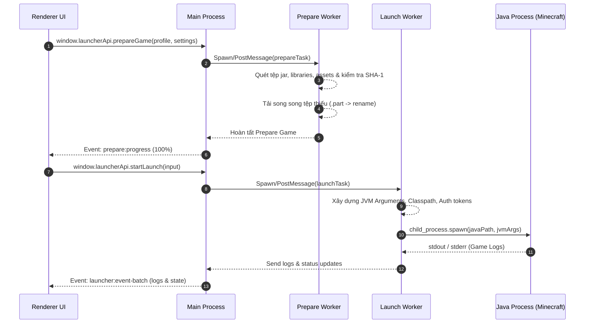

# Kiến Trúc Hệ Thống LetCuteMC Launcher

Tài liệu này mô tả chi tiết kiến trúc tổng thể, mô hình đa tiến trình (Multi-process Architecture), cơ chế truyền thông IPC và luồng xử lý dữ liệu của ứng dụng **LetCuteMC Launcher**.

---

## 1. Mô Hình Đa Tiến Trình (Multi-Process Model)

LetCuteMC tận dụng kiến trúc đệm an toàn và hiệu năng cao của Electron kết hợp với **Node.js Worker Threads** để đảm bảo giao diện người dùng (UI) luôn luôn mượt mà (60+ FPS), không bị đơ giật ngay cả khi đang quét và tải hàng nghìn tệp tin game.

```mermaid
flowchart TD
    subgraph RendererProcess["UI Process (React 19 / Vite)"]
        UI[React Components & Screens]
        CustomHooks[React Hooks & Local State]
        PreloadAPI["window.launcherApi (Bridge)"]
        UI --> CustomHooks
        CustomHooks --> PreloadAPI
    end

    subgraph MainProcess["Main Process (Electron / Node.js)"]
        BrowserWin[BrowserWindow Lifecycle]
        IPCHandler[IPC Dispatcher src/main/ipc.ts]
        Services[20+ Backend Services]
        LauncherState[In-Memory State & Log Buffers]
        
        PreloadAPI <-->|IPC Invoke / Handle & Events| IPCHandler
        IPCHandler --> Services
        Services --> LauncherState
    end

    subgraph WorkerThreads["Worker Threads (Node worker_threads)"]
        PrepWorker["prepareWorker.ts (Check/Download Assets)"]
        LaunchWorker["launchWorker.ts (Java Launch & Monitor)"]
        
        Services <-->|parentPort postMessage| WorkerThreads
    end

    Services -->|System / Disk / Web| OS["Operating System & Mojang/Forge APIs"]
```

### 1.1 Renderer Process (Giao diện Người dùng)
- **Công nghệ**: React 19, TypeScript, Vite, TailwindCSS & `@base-ui/react`.
- **Nhiệm vụ**: Hiển thị các màn hình điều khiển (Profiles, Accounts, Mods, Settings, Logs, Versions), tiếp nhận tương tác người dùng và phản hồi trực quan theo thời gian thực.
- **Bảo mật**: Chạy dưới môi trường sandbox isolate. Renderer không trực tiếp truy cập Node.js API hay File System mà giao tiếp thông qua cầu nối `window.launcherApi`.

### 1.2 Main Process (Tiến trình Chính)
- **Công nghệ**: Electron Main, Node.js runtime.
- **Nhiệm vụ**:
  - Khởi tạo và quản lý cửa sổ không viền (`BrowserWindow` với `frame: false`).
  - Đăng ký và xử lý các sự kiện IPC từ Renderer.
  - Quản lý trạng thái ứng dụng lưu trữ trên ổ đĩa (Cấu hình Profiles, Tài khoản, Cài đặt).
  - Điều phối các Worker Threads xử lý tác vụ nặng.

### 1.3 Worker Threads (Tiến trình Xử lý Nặng)
- **Công nghệ**: Node.js `worker_threads` module.
- **Tệp tin**:
  - `src/main/workers/prepareWorker.ts`: Xử lý quét cấu trúc phiên bản, tải danh sách thư viện (libraries), assets và kiểm tra mã băm SHA-1.
  - `src/main/workers/launchWorker.ts`: Thực hiện chuẩn bị tham số JVM, giải nén native libraries và kích hoạt tiến trình Java Minecraft độc lập.
- **Lợi ích**: Tách rời tác vụ tính toán mã băm SHA-1 và I/O đĩa nặng khỏi Tiến trình Main, tránh làm gián đoạn luồng xử lý sự kiện (Event Loop).

---

## 2. Cơ Chế Giao Tiếp IPC (Inter-Process Communication)

Giao tiếp giữa Renderer Process và Main Process tuân thủ nguyên tắc **Strict Context Isolation**.

```
[Renderer UI] ──(call)──> [preload.ts (contextBridge)] ──(ipcRenderer.invoke)──> [ipc.ts (ipcMain.handle)] ──> [Services]
[Renderer UI] <──(listener)── [preload.ts (ipcRenderer.on)] <──(event emit)── [ipc.ts (webContents.send)] <── [Workers/Services]
```

### 2.1 Mẫu Giao Tiếp Yêu Cầu - Phản Hồi (Request - Response)
- Renderer gọi phương thức bất đồng bộ từ `window.launcherApi.<method>()`.
- Preload gửi thông điệp IPC dạng `ipcRenderer.invoke(channel, ...args)`.
- Main Process nhận qua `ipcMain.handle(channel, handler)` và trả về `Promise<TResult>`.

### 2.2 Luồng Dữ Liệu Sự Kiện Thời Gian Thực (Event Streaming)
- Đối với các tiến trình chạy nền như **Prepare Game** và **Launch Game**, Main Process phát các sự kiện tiến độ:
  - Channel `prepare:progress`: Cập nhật phần trăm %, công việc đang chạy, dung lượng đã tải.
  - Channel `launcher:event-batch`: Nhóm các sự kiện log dòng lệnh, trạng thái thay đổi để gửi theo đợt (batching) nhằm tối ưu hiệu năng render của React.

---

## 3. Quản Lý Trạng Thái & Dữ Liệu (State & Persistence)

Ứng dụng lưu trữ các thiết lập và cấu hình dưới dạng tệp tin JSON nằm trong thư mục dữ liệu ứng dụng chuẩn của hệ điều hành (AppData trên Windows):

- **Profiles Store**: Khởi tạo và lưu tại `<AppData>/letcutemc/profiles.json`. Quản lý danh sách các hồ sơ game riêng biệt.
- **Settings Store**: Khởi tạo và lưu tại `<AppData>/letcutemc/settings.json`. Chứa thiết lập RAM, Java, đường dẫn game, số luồng tải song song, chế độ hiệu năng.
- **Accounts Store**: Khởi tạo và lưu tại `<AppData>/letcutemc/accounts.json`. Chứa thông tin tài khoản Offline và Microsoft OAuth Tokens.

---

## 4. Luồng Khởi Chạy Game (Game Launch Pipeline)

Quá trình khởi chạy một phiên bản Minecraft trải qua 6 giai đoạn nghiêm ngặt:



1. **Kiểm tra Cấu hình (Validation)**: Kiểm tra thông tin RAM, tài khoản và đường dẫn Java Runtime phù hợp.
2. **Quét & Xác minh Tệp Game (Verification)**: Quét toàn bộ tệp `.json` phiên bản, thư viện `.jar`, tài sản assets và đối chiếu mã băm SHA-1.
3. **Tải Tệp thiếu / Bị hỏng (Download & Repair)**: Tải xuống các tệp còn thiếu qua cơ chế tải tạm `.part` và đổi tên chính thức sau khi kiểm tra checksum SHA-1.
4. **Chuẩn bị Môi trường Java (Java & Native Unpack)**: Giải nén các thư viện native (`.dll`, `.so`, `.dylib`) vào thư mục tạm của phiên bản.
5. **Khởi chạy Tiến trình Game (Spawn Java Process)**: Xây dựng tham số khởi chạy JVM hoàn chỉnh và gọi `child_process.spawn`.
6. **Lắng nghe Nhật ký & Theo dõi (Log Streaming & Process Monitor)**: Đọc luồng `stdout`/`stderr` từ game, chuyển đổi thành danh sách Log trong ứng dụng và phát hiện khi game đóng (`exit code`).
