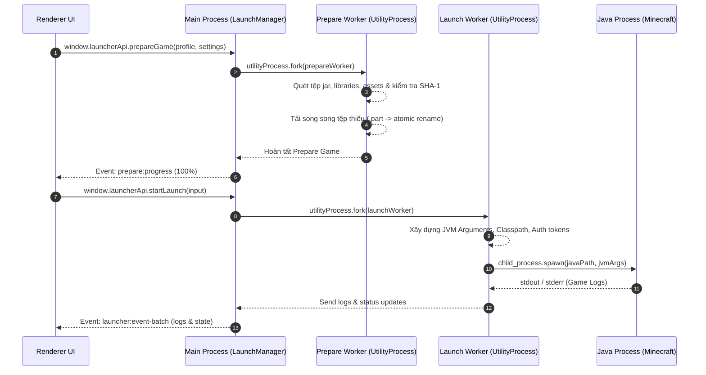

# Kiến Trúc Hệ Thống LetCuteMC Launcher

Tài liệu này mô tả chi tiết kiến trúc tổng thể, mô hình đa tiến trình (Multi-process Architecture), cơ chế truyền thông IPC và luồng xử lý dữ liệu của ứng dụng **LetCuteMC Launcher**.

---

## 1. Mô Hình Đa Tiến Trình (Multi-Process Model)

LetCuteMC tận dụng kiến trúc an toàn và hiệu năng cao của Electron kết hợp với **Electron `utilityProcess`** để đảm bảo giao diện người dùng (UI) luôn luôn mượt mà (60+ FPS), không bị đơ giật ngay cả khi đang quét và tải hàng nghìn tệp tin game.

```mermaid
flowchart TD
    subgraph RendererProcess["UI Process (React 19 / Vite)"]
        UI[React Components & Screens]
        CustomHooks[React Hooks & Local State]
        PreloadAPI["window.launcherApi (Bridge)"]
        UI --> CustomHooks
        CustomHooks --> PreloadAPI
    end

    subgraph MainProcess["Main Process (Electron / Node.js)"]
        BrowserWin[BrowserWindow Lifecycle]
        IPCHandler[IPC Dispatcher src/main/ipc/]
        Services[44 Backend Services]
        LauncherState[In-Memory State & Log Buffers]
        
        PreloadAPI <-->|IPC Invoke / Handle & Events| IPCHandler
        IPCHandler --> Services
        Services --> LauncherState
    end

    subgraph UtilityWorkers["Utility Processes (Electron utilityProcess.fork)"]
        PrepWorker["prepareWorker.ts (Check/Download Assets/SHA-1)"]
        LaunchWorker["launchWorker.ts (Java Launch & Monitor)"]
        
        Services <-->|parentPort postMessage| UtilityWorkers
    end

    Services -->|System / Disk / Web| OS["Operating System & Mojang/Forge/Modrinth APIs"]
```

### 1.1 Renderer Process (Giao diện Người dùng)
- **Công nghệ**: React 19, TypeScript, Vite, TailwindCSS & `@base-ui/react`.
- **Nhiệm vụ**: Hiển thị các màn hình điều khiển (Profiles, Accounts, Mods, Settings, Logs, Versions, Worlds, Screenshots, Optimizer), tiếp nhận tương tác người dùng và phản hồi trực quan theo thời gian thực.
- **Bảo mật**: Chạy dưới môi trường sandbox isolate. Renderer không trực tiếp truy cập Node.js API hay File System mà giao tiếp thông qua cầu nối `window.launcherApi`.

### 1.2 Main Process (Tiến trình Chính)
- **Công nghệ**: Electron Main, Node.js runtime.
- **Nhiệm vụ**:
  - Khởi tạo và quản lý cửa sổ không viền (`BrowserWindow` với `frame: false`).
  - Đăng ký và xử lý các sự kiện IPC từ Renderer qua `src/main/ipc/`.
  - Quản lý trạng thái ứng dụng lưu trữ trên ổ đĩa (Cấu hình Profiles, Tài khoản, Cài đặt).
  - Điều phối các `utilityProcess` xử lý tác vụ nặng.

### 1.3 Utility Processes (Tiến trình Xử lý Nặng)
- **Công nghệ**: Electron `utilityProcess` (forked via `workerResolver.ts`).
- **Tệp tin**:
  - `src/main/workers/prepareWorker.ts`: Xử lý quét cấu trúc phiên bản, tải danh sách thư viện (libraries), assets, kiểm tra mã băm SHA-1 và tự động sửa dependency của mod.
  - `src/main/workers/launchWorker.ts`: Thực hiện chuẩn bị tham số JVM, classpath, giải nén native libraries và kích hoạt tiến trình Java Minecraft độc lập qua `child_process.spawn`.
- **Lợi ích**: Chạy trên tiến trình Node.js độc lập với Main Process, không chiếm giữ Event Loop của Main Process, đảm bảo UI hoàn toàn không bị giật lag khi tải hoặc hash file dung lượng lớn.

---

## 2. Cơ Cấu Tổ Chức Dịch Vụ Backend (Services Directory)

Tất cả logic nghiệp vụ backend được đặt tại `src/main/services/`, phân chia theo domain:

### 2.1 Auth (`src/main/services/auth/`)
| Service | Chức năng chính |
|---|---|
| `accountService.ts` | Quản lý state tài khoản, lưu trữ `accounts.json`, chọn tài khoản active, thêm/xóa tài khoản offline, đổi tên local, lưu skin local. |
| `microsoftAuthService.ts` | Xác thực tài khoản Microsoft qua luồng OAuth2 PKCE với local HTTP server tạm (port 53248), refresh token. |
| `mojangApiService.ts` | Giao tiếp API Mojang chính thức: lấy profile, upload skin, đổi cape, kiểm tra/thực hiện đổi tên. |

### 2.2 Content (`src/main/services/content/`)
| Service | Chức năng chính |
|---|---|
| `gameContentService.ts` | Quét, phân tích tệp `.jar`, bật/tắt (`.disabled`), xóa, import mod, resource pack, shader pack. |
| `modConflictService.ts` | Phát hiện xung đột phiên bản mod, mod trùng lặp và xung đột loader; cung cấp gợi ý tự động giải quyết. |
| `modDependencyService.ts` | Đọc `fabric.mod.json`, `mods.toml`, `mcmod.info` để phân tích dependency; tự động tải dependency thiếu từ Modrinth. |
| `modLoaderService.ts` | Truy vấn danh sách phiên bản và tự động cài đặt Fabric, Quilt, Forge, NeoForge vào thư mục game. |
| `modrinthService.ts` | Tìm kiếm Modrinth API, tải modpack (`.mrpack`), quản lý cài đặt mod từ kho Modrinth. |
| `modUpdaterService.ts` | Kiểm tra phiên bản mới của các mod đã cài đặt qua Modrinth API và cập nhật tự động. |
| `preLaunchIntegrityService.ts` | Kiểm tra tính toàn vẹn cấu trúc phiên bản, file jar và dependency mod trước khi kích hoạt launch. |
| `skinIntegrationService.ts` | Tự động inject CustomSkinLoader vào game khi cần hiển thị skin cho tài khoản offline/custom. |

### 2.3 Launcher (`src/main/services/launcher/`)
| Service | Chức năng chính |
|---|---|
| `crashDiagnostic.ts` | Phân tích mã lỗi thoát (exit code), đọc crash report và đưa ra chẩn đoán nguyên nhân cùng giải pháp. |
| `javaInstallerService.ts` | Tự động tải và giải nén Java Runtime (Adoptium / Zulu) vào thư mục `managed-java/`. |
| `javaResolver.ts` | Xác định phiên bản Java yêu cầu theo phiên bản Minecraft và điều hướng tới runtime phù hợp. |
| `javaScannerService.ts` | Quét hệ thống tìm các bản cài đặt Java, kiểm tra tính hợp lệ và tự động chọn bản tốt nhất. |
| `launchManager.ts` | Quản lý vòng đời khởi chạy game, fork `launchWorker`, theo dõi trạng thái process, buffer log. |
| `minecraftDirectoryService.ts` | Tự động dò tìm đường dẫn `.minecraft` mặc định trên từng hệ điều hành. |
| `minecraftScannerService.ts` | Quét toàn diện cấu trúc thư mục game (versions, mods, saves, resourcepacks). |
| `prepareGameService.ts` | Quản lý tiến trình chuẩn bị game, fork `prepareWorker`, quản lý cache trạng thái prepared. |
| `versionManifestCacheService.ts` | Quản lý cache version manifest của Mojang (`version_manifest_v2.json`) trên ổ đĩa. |
| `versionResolver.ts` | Phân tích inheritance của phiên bản, giải quyết libraries, asset index và arguments JVM. |
| `versionService.ts` | Tổng hợp catalog phiên bản Minecraft từ Mojang (Release, Snapshot, Beta, Alpha) và các bản cài thủ công. |

### 2.4 Media (`src/main/services/media/`)
| Service | Chức năng chính |
|---|---|
| `errorLogService.ts` | Ghi log lỗi nội bộ của launcher vào thư mục `error-logs/`. |
| `lanDiscoveryService.ts` | Lắng nghe gói tin UDP multicast (224.0.2.60:4445) để phát hiện server Minecraft LAN trong mạng nội bộ. |
| `logService.ts` | Đọc, quản lý danh sách file log game, crash report và upload log lên mclo.gs. |
| `screenshotService.ts` | Quét thư mục ảnh chụp màn hình, sao chép vào clipboard, xóa ảnh đơn/hàng loạt. |
| `serverListService.ts` | Đọc danh sách server phổ biến và hỗ trợ inject vào `servers.dat` của game. |
| `statsService.ts` | Đọc dữ liệu thống kê từ file `stats/*.json` trong world save (thời gian chơi, đào khoáng, mob, di chuyển). |
| `worldService.ts` | Quét các thế giới (saves), tạo/khôi phục backup zip, nhân bản, đổi tên (chỉnh `level.dat`) và xóa world. |

### 2.5 Profile (`src/main/services/profile/`)
| Service | Chức năng chính |
|---|---|
| `profileService.ts` | CRUD cấu hình hồ sơ chơi trong `profiles.json`, quản lý profile active. |
| `profilePackageService.ts` | Đóng gói xuất/nhập hồ sơ chơi thành tệp `.letcutepack` để chia sẻ trọn gói (cấu hình + mods + settings). |

### 2.6 System (`src/main/services/system/`)
| Service | Chức năng chính |
|---|---|
| `autoUpdaterService.ts` | Tích hợp `electron-updater` kiểm tra và tải bản cập nhật launcher tự động. |
| `discordRpcService.ts` | Cập nhật trạng thái Rich Presence trên Discord (phiên bản đang chơi, thời gian). |
| `downloadManager.ts` | Quản lý tải tệp đa luồng, hỗ trợ cơ chế retry, file tạm `.part` và xác minh SHA-1. |
| `httpAgent.ts` | Khởi tạo global HTTP dispatcher tối ưu (`undici`) với connection pooling cho tốc độ tải tối đa. |
| `mirrorService.ts` | Cung cấp danh sách mirror URL (BMCLAPI) tăng tốc tải tệp thư viện và assets tại khu vực châu Á. |
| `optimizerService.ts` | Cung cấp các preset JVM args tối ưu, quét/dọn dẹp cache game và tinh chỉnh `options.txt`. |
| `performanceTunerService.ts` | Tính toán cấu hình RAM và tham số JVM tối ưu dựa trên phần cứng thực tế của máy. |
| `settingsService.ts` | Quản lý cấu hình launcher trong `settings.json` và phân giải cấu hình hiệu năng có hiệu lực. |
| `storageService.ts` | Định nghĩa các đường dẫn chuẩn: launcher data, cache, managed-java, backups. |
| `systemInfoService.ts` | Lấy thông tin tài nguyên hệ thống (số core CPU, dung lượng RAM thực tế, hệ điều hành). |
| `taskManagerService.ts` | Quản lý hàng đợi các tác vụ nền (background tasks), phát tiến độ qua IPC event stream. |

### 2.7 Root Services
| File | Chức năng chính |
|---|---|
| `eventBus.ts` | Typed `AppEventBus` kế thừa `EventEmitter` xử lý pub/sub nội bộ giữa các service (`game:launching`, `game:started`, `game:exited`, `game:crashed`, `profile:updated`, `profile:deleted`). |
| `index.ts` | Barrel file re-export toàn bộ 44 service để import thuận tiện. |

---

## 3. Cơ Chế Giao Tiếp IPC (Inter-Process Communication)

Giao tiếp giữa Renderer Process và Main Process tuân thủ nguyên tắc **Strict Context Isolation**.

```
[Renderer UI] ──(call)──> [preload.ts (contextBridge)] ──(ipcRenderer.invoke)──> [ipc/index.ts (ipcMain.handle)] ──> [Services]
[Renderer UI] <──(listener)── [preload.ts (ipcRenderer.on)] <──(event emit)── [webContents.send] <── [Workers/Services]
```

### 3.1 Cấu Trúc IPC Handlers (`src/main/ipc/`)
Các handler được phân chia thành 7 domain mô-đun đăng ký tập trung qua `src/main/ipc/index.ts`:

- `accountIpc.ts`: Tài khoản local, Microsoft OAuth, Mojang API.
- `contentIpc.ts`: Quét mods/packs, bật/tắt, mod loader, mod dependencies, auto-update mod, xung đột mod.
- `launchIpc.ts`: Start/cancel launch, prepare game, cache manifest, get state.
- `modrinthIpc.ts`: Tìm kiếm, tải modpack, cài đặt từ store, danh sách server.
- `profileIpc.ts`: CRUD profiles, xuất/nhập gói `.letcutepack`.
- `systemIpc.ts`: Settings, system info, Java scanning/install, JVM optimizer, window controls, dialogs, tasks, updater, discord.
- `statsIpc.ts`: Worlds & saves, screenshots gallery, logs & crash reports, stats in-game, LAN discovery.

Chi tiết từng kênh IPC xem tại [`docs/IPC_API.md`](./IPC_API.md).

---

## 4. Quản Lý Trạng Thái & Dữ Liệu (State & Persistence)

Ứng dụng lưu trữ các thiết lập và cấu hình dưới dạng tệp tin JSON nằm trong thư mục dữ liệu ứng dụng chuẩn của hệ điều hành (`%APPDATA%/letcutemc` trên Windows):

- **Profiles Store**: Lưu tại `<AppData>/letcutemc/profiles.json`. Quản lý danh sách các hồ sơ game riêng biệt.
- **Settings Store**: Lưu tại `<AppData>/letcutemc/settings.json`. Chứa thiết lập RAM, Java, đường dẫn game, số luồng tải, chế độ hiệu năng.
- **Accounts Store**: Lưu tại `<AppData>/letcutemc/accounts.json`. Chứa thông tin tài khoản Offline và Microsoft OAuth Tokens (được mã hóa khi cần).

---

## 5. Luồng Khởi Chạy Game (Game Launch Pipeline)

Quá trình khởi chạy một phiên bản Minecraft trải qua 6 giai đoạn nghiêm ngặt:



1. **Kiểm tra Cấu hình (Validation)**: Kiểm tra thông tin RAM, tài khoản và đường dẫn Java Runtime phù hợp.
2. **Quét & Xác minh Tệp Game (Verification)**: Quét toàn bộ tệp `.json` phiên bản, thư viện `.jar`, tài sản assets và đối chiếu mã băm SHA-1.
3. **Tải Tệp thiếu / Bị hỏng (Download & Repair)**: Tải xuống các tệp còn thiếu qua cơ chế tải tạm `.part` và đổi tên chính thức sau khi kiểm tra checksum SHA-1.
4. **Chuẩn bị Môi trường Java (Java & Native Unpack)**: Giải nén các thư viện native (`.dll`, `.so`, `.dylib`) vào thư mục tạm của phiên bản.
5. **Khởi chạy Tiến trình Game (Spawn Java Process)**: Xây dựng tham số khởi chạy JVM hoàn chỉnh và gọi `child_process.spawn` độc lập với launcher.
6. **Lắng nghe Nhật ký & Theo dõi (Log Streaming & Process Monitor)**: Đọc luồng `stdout`/`stderr` từ game, chuyển đổi thành danh sách Log trong ứng dụng và phát hiện khi game đóng (`exit code`).
