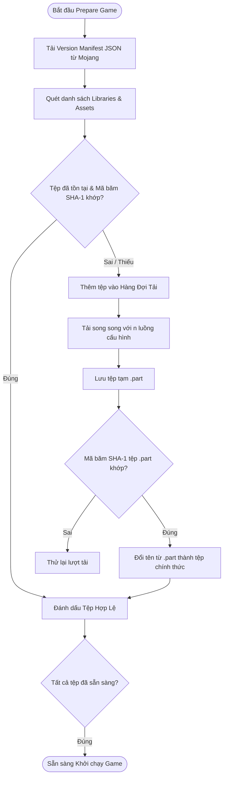

# Đặc Tả Các Tính Năng Kỹ Thuật (Features Specification)

Tài liệu này giải thích chuyên sâu cơ chế hoạt động của các tính năng kỹ thuật cốt lõi trong **LetCuteMC Launcher**.

---

## 1. Tự Động Quét & Cài Đặt Java Runtime (Java Scanner & Auto-Installer)

Khởi chạy Minecraft đòi hỏi một môi trường Java Runtime (JRE/JDK) chính xác tương thích với phiên bản game. LetCuteMC tự động giải quyết bài toán môi trường Java cho người dùng một cách hoàn toàn tự động.

### 1.1 Bảng Tương Thích Phiên Bản Java
Dựa trên phiên bản Minecraft mà hồ sơ (Profile) yêu cầu, hệ thống tự động xác định Java Major Version tối thiểu:

| Phiên bản Minecraft | Java Major Version Yêu cầu |
| :--- | :--- |
| Minecraft < 1.17 | **Java 8** (Legacy Runtime) |
| Minecraft 1.17 - 1.17.1 | **Java 16** |
| Minecraft 1.18 - 1.20.4 | **Java 17** |
| Minecraft >= 1.20.5 | **Java 21** |

### 1.2 Luồng Dò Tìm Java Runtime (`javaScannerService.ts`)
Khi người dùng chuẩn bị vào game, ứng dụng thực hiện các bước quét:
1. **Registry Scan**: Tìm kiếm thông tin đăng ký Java trên Windows Registry tại đường dẫn `HKLM\SOFTWARE\JavaSoft\Java Development Kit` và `Java Runtime Environment`.
2. **Path Scan**: Quét các đường dẫn cài đặt mặc định (`C:\Program Files\Java`, `C:\Program Files\Eclipse Adoptium`, `%LOCALAPPDATA%\Programs`, v.v.).
3. **Environment Variable**: Kiểm tra biến môi trường `JAVA_HOME` và biến `PATH`.
4. **Custom Directories**: Quét thêm các thư mục người dùng tự định nghĩa trong trang Settings.

### 1.3 Tự Động Cài Đặt OpenJDK (`javaInstallerService.ts`)
Nếu trên máy tính người dùng **chưa có** bản Java phù hợp:
1. Launcher tự động gửi yêu cầu lấy bản phân phối **Eclipse Temurin (Adoptium)** tương ứng với kiến trúc hệ điều hành (Windows x64 / ARM64).
2. Tải gói nén nén `.zip` với thanh phần trăm hiển thị tiến độ thời gian thực.
3. Giải nén vào thư mục quản lý riêng của launcher: `<AppData>/letcutemc/managed-java/java-<version>/`.
4. Tự động kiểm tra tính hợp lệ của lệnh `bin/java.exe` và liên kết trực tiếp vào cấu hình phiên bản.

---

## 2. Kiểm Tra Mã Băm SHA-1 & Tải Tệp Tin Song Song (Parallel Downloader & SHA-1 Verification)

Để ngăn ngừa lỗi game bị văng (crash) do tệp tin tải về bị hỏng hoặc thiếu thư viện, LetCuteMC triển khai thuật toán kiểm tra và tải xuống nghiêm ngặt trong `prepareWorker.ts`.

### 2.1 Cơ Chế Tải Song Song (Multi-Thread Concurrency)
- Số luồng tải song song có thể điều chỉnh linh hoạt từ 1 đến 16 luồng trong trang Cài Đặt (mặc định tối ưu theo số nhân CPU).
- Sử dụng HTTP Stream kết hợp bộ nạp đệm để đạt tốc độ tải tối đa băng thông mà không làm treo ứng dụng.

### 2.2 Đảm Bảo An Toàn Dữ Liệu Với Tệp Tạm `.part`
- Mọi tệp tin tải về ban đầu đều được ghi dưới dạng đuôi mở rộng `.part` (ví dụ: `library.jar.part`).
- Sau khi tải xong, hệ thống tính toán checksum mã băm SHA-1 của tệp `.part` và đối chiếu với hash từ Mojang Server.
- Chỉ khi hai mã băm **trùng khớp tuyệt đối**, tệp mới được đổi tên (atomic rename) thành tên chính thức. Điều này ngăn chặn triệt để tình trạng tệp nạp dở dang khi bị mất kết nối mạng.

### 2.3 Tính Năng Sửa Lỗi (Repair Mode)
- Khi bật chế độ Sửa Lỗi (Repair), launcher sẽ bỏ qua bộ nhớ đệm và quét lại mã băm SHA-1 của từng tệp trong thư mục `.minecraft`. Bất kỳ tệp tin nào có mã băm không khớp sẽ tự động bị xóa và tải lại bản gốc chuẩn từ server.

---

## 3. Quản Lý Tài Nguyên Mở Rộng (Mods, Resource Packs, Shader Packs)

LetCuteMC tích hợp trình quản lý nội dung game trực quan (`gameContentService.ts`), hỗ trợ các loại tài nguyên mở rộng.

### 3.1 Đọc Metadata Tệp Mod (`.jar`)
Khi quét thư mục `mods/`, launcher đọc cấu trúc bên trong tệp nén `.jar` để trích xuất thông tin hiển thị:
- **Fabric Mod**: Đọc tệp `fabric.mod.json` (Trích xuất Mod ID, Name, Version, Description, Icon).
- **Quilt Mod**: Đọc tệp `quilt.mod.json`.
- **Forge / NeoForge Mod**: Đọc tệp `mcmod.info` hoặc `META-INF/mods.toml`.

### 3.2 Cơ Chế Bật / Tắt Nhanh (Enable / Disable Toggle)
Thay vì xóa hoặc di chuyển tệp ra khỏi thư mục game, LetCuteMC áp dụng cơ chế đổi đuôi tệp cực kỳ an toàn và tức thì:
- **Tắt Mod / Tài nguyên**: Thêm hậu tố `.disabled` vào tên tệp (Ví dụ: `optifine.jar` -> `optifine.jar.disabled`). Minecraft sẽ tự động bỏ qua các tệp có đuôi `.disabled`.
- **Bật Mod / Tài nguyên**: Đổi lại tên tệp loại bỏ hậu tố `.disabled`.

---

## 4. Xác Thực Tài Khoản (Authentication System)

Hệ thống hỗ trợ 2 chế độ chơi linh hoạt trong `accountService.ts` và `microsoftAuthService.ts`:

### 4.1 Chế Độ Ngoại Tuyến (Offline / Virtual Account)
- Cho phép tạo tài khoản chơi nhanh mà không cần kết nối internet.
- Tự động tạo UUID ngẫu nhiên hợp lệ dựa trên thuật toán hash v3 Offline Player Name của Minecraft.

### 4.2 Chế Độ Microsoft OAuth chính thức
- Tích hợp luồng xác thực bảo mật chuẩn Microsoft OAuth 2.0 Device Code / Web Authentication.
- Trao đổi token theo chuỗi liên hoàn: `Microsoft Access Token` -> `Xbox Live Authenticate` -> `XSTS Token` -> `Mojang Access Token`.
- Tự động làm mới Refresh Token chạy ngầm để duy trì trạng thái đăng nhập cho người dùng.

---

## 5. Tối Ưu Hiệu Năng Tự Động (Auto Performance Tuning)

`performanceTunerService.ts` phân tích cấu hình hệ thống phần cứng và tự động đưa ra thiết lập gợi ý:
- **Phân bổ RAM tự động**: Tự động tính toán số RAM tối thiểu (`-Xms`) và tối đa (`-Xmx`) phù hợp dựa trên tổng dung lượng RAM của máy tính (tránh tình trạng gán quá nhiều RAM làm tràn bộ nhớ HĐH).
- **Tối ưu JVM Arguments**: Tự động thêm các cờ tối ưu rác (Shenandoah GC, G1GC optimization flags) giúp giảm giật lag khi chơi game.
